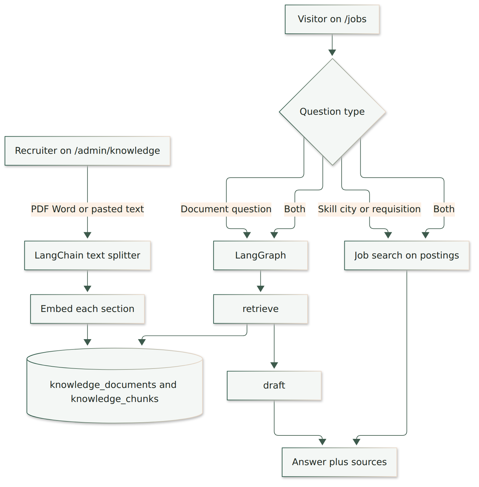
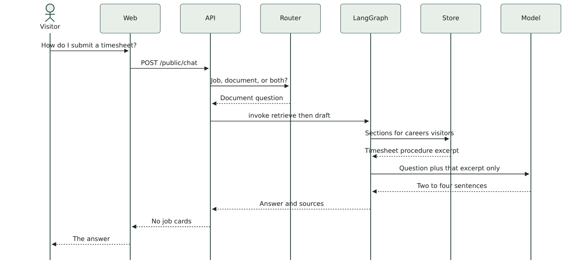
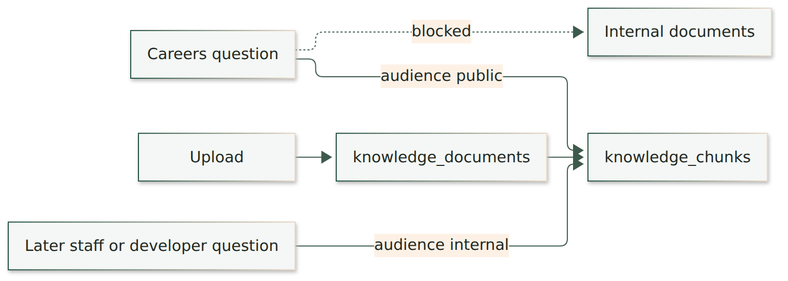

# Knowledge base

How a recruiter adds documents, and how a visitor question is answered from those documents with LangChain and LangGraph.

The careers page still searches open jobs. A question about a document — benefits, onboarding, an expense procedure, a timesheet rule — does not search postings. It retrieves sections from the knowledge base and asks the model to answer only from those sections.

Upload and edit live at `/admin/knowledge` after you sign in. The nav label is **Knowledge**.

## Two audiences

| Audience | Who can ask | Examples |
| --- | --- | --- |
| Careers visitors | Anyone on `/jobs` | Benefits, holiday list, expense procedure, onboarding |
| Internal only | Nobody on the public site | A research note or a draft you are not ready to publish |

The public database role cannot read `knowledge_documents` or `knowledge_chunks`. The API reads them on the server and returns only the short excerpts used in the answer. Internal documents are stored in the same tables and are filtered out before a careers question is searched.

## Architecture



A recruiter uploads a file or pastes text. LangChain splits that text into overlapping sections of about 900 characters. Each section is embedded with the same nomic model already used for jobs and stored beside the original document. The original text stays on the document so an edit can be split and embedded again.

A visitor question is classified in code, not by the model:

- “Java and AWS” or “Jobs in Chantilly” searches postings.
- “How do I submit a timesheet?” or “What is the 401k match?” searches the knowledge base.
- “Does the AWS role include dental insurance?” does both. The job cards come from the postings. The dental rule, if a document states it, is added to the prompt that writes the sentence.

## How one question is answered



LangGraph is the small workflow with two steps. LangChain is the splitter used when the document is saved. The model does not choose which step runs, and it does not see the rest of the library.

1. **retrieve** loads careers-visitor sections and keeps the ones that share words with the question or sit close to it in the embedding space. At most a few documents are kept, one section each.
2. **draft** sends the question and those excerpts to the model. The instruction says to use only the excerpts, name the document, and refuse anything the excerpts do not state. If retrieve found nothing, draft does not call the model. The answer is “That is not in the knowledge base on file.”

The page shows the document title and the excerpt under the sentence, so a reader can see the line the answer came from.

## What is stored



`knowledge_documents` holds the title, the audience, the file name, and the full text. `knowledge_chunks` holds one section, its order, and a 768-number embedding. Deleting a document deletes its sections.

## LangChain, in this project

LangChain’s text splitter is the only LangChain piece used today. It breaks a long document on paragraph breaks, then lines, then sentences, with a 120-character overlap so a rule that sits on a boundary is still in one of the sections.

Example. An expense document contains two rules. After the split, retrieval can return just the meal rule when the question is about dinner:

```text
Title: Expense procedure

Section 0
Meals on an overnight trip are reimbursed up to 60 dollars a day.
Save the itemized receipt.

Section 1
Mileage is reimbursed at the current IRS rate.
Trips under 10 miles are not reimbursed.
```

Question: “What is the meal limit on a trip?”

The retrieve step keeps section 0 because it shares “meal” with the question. Section 1 stays in the database and is not sent to the model. The draft step is told the title and section 0 only, so it can say 60 dollars and cannot invent a mileage number.

A second example is a short paste. A document shorter than one chunk stays one section. The same retrieve and draft steps run. Length does not change the graph.

## LangGraph, in this project

The graph is fixed. Every document question walks the same two nodes. There is no agent deciding to search the web or to open a candidate record.


State passed between the nodes:

| Field | Set by | Meaning |
| --- | --- | --- |
| question | The visitor | The sentence they typed |
| passages | retrieve | Title, excerpt, and score |
| answer | draft | The sentence shown on the page |

Example. “How do I submit a timesheet?” enters `retrieve` with an empty passage list. The node fills `passages` from the Timesheet procedure document. `draft` reads that list, calls the model, and sets `answer`. The API returns the answer and the sources. Job cards are an empty list.

Example. “What is the sabbatical policy?” enters the same graph. If no section shares those words or is close as an embedding, `passages` stays empty. `draft` returns the fixed sentence that the knowledge base does not contain it. The model is not asked to guess.

Example. “Does the AWS role include dental insurance?” does not take this graph alone. The router also runs the job search. The dental excerpt, when one exists, is appended to the job prompt so the sentence can mention both the role and the document. The graph itself is unchanged.

## What you can upload

PDF, DOC, DOCX, or TXT, or text pasted into the form. The title is required. Pick **Careers visitors** or **Internal only**. After it is saved you can change the title, the audience, and the text, or delete it. A text change splits and embeds the document again.

The form is general. A handbook is one document among others. A research summary marked internal is stored the same way and is not searched by `/jobs`.

## What this does not do yet

A careers visitor cannot ask an internal document. There is no separate developer chat. The model does not walk from one paper to another. Those are later nodes on this same graph: another retrieve step for papers, and a draft step that must quote a page. The careers path above stays as it is.
